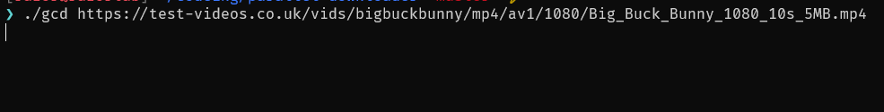

# Go Concurrent Downloader (`gdl`)

A high-performance, concurrent command-line file downloader written in Go with **zero 3rd-party dependencies**.

This project was built as an exploration into Go's concurrency primitives (`goroutines`, `sync.WaitGroup`, `channels`), POSIX-level concurrent file I/O (`pwrite`/`WriteAt`), and HTTP byte-range specifications (`RFC 7233`) — relying solely on the Go Standard Library.

> [!NOTE]
> **Why `gdl` instead of `gcd`?**
> If you or your users use Oh My Zsh or popular dotfile sets with the `git` plugin enabled:
> `gcd` is often defined as an alias for:
> ```bash
> alias gcd='git checkout $(git_develop_branch)'
> # or 'git checkout dev'
> ```
> If that plugin is loaded, the shell alias takes precedence over binary paths in `$PATH`. To avoid naming collisions and guarantee seamless invocation across all terminal environments, the binary is named **`gdl`**.

---

## 🚀 Features

- **Zero 3rd-Party Dependencies**: Crafted purely with the Go standard library (`net/http`, `os`, `sync`, `math`, `time`, etc.). No external libraries, bloat, or supply-chain dependencies.
- **Concurrent Multi-Chunk Downloads**: Splits large files into distinct byte segments downloaded concurrently using HTTP `Range` headers.
- **Direct Concurrent File Writes**: Pre-allocates the destination file with `file.Truncate` and writes chunks concurrently using thread-safe `file.WriteAt`, completely eliminating temporary chunk files and sequential merge overhead.
- **In-Memory Chunk Slicing**: Calculates segment offsets cleanly using a lightweight `ChunkSlice` model (`start`/`end`), dispatching workers with no intermediate file tracking.
- **Interactive Visual CLI Progress Bar**: Real-time ANSI two-line display featuring a visual block progress bar (`█████▒▒▒▒▒`), download percentage, and human-readable byte counts (`B`, `KB`, `MB`, `GB`, `TB`).
- **Decoupled Real-Time Progress Pipeline**: Emits byte updates via buffered channels (`chan int64`) to a dedicated UI goroutine without blocking concurrent network I/O.
- **Adaptive Chunk & Connection Sizing**: Intelligently scales chunk counts (from 1 stream for small files up to a maximum cap of 8 connections) to maximize throughput while avoiding HTTP 429 (Rate Limit) throttling.
- **Graceful Fallback**: Automatically checks for `Accept-Ranges: bytes` support via a `HEAD` request and falls back to single-stream download if range requests are unsupported.
- **Build Metadata & Versioning**: Injects version tags, commit hashes, and build timestamps at link time (`--version` flag).
- **Cross-Platform & Automated Releases**: Pre-compiled standalone binaries for Linux (`amd64`, `arm64`), macOS (`amd64`, `arm64`), and Windows (`amd64`) generated via GitHub Actions CI/CD.

---

### 📺 CLI Interface Preview



---

## 🧠 What I Tried & The Evolution of the Tool

Building this tool was an iterative journey that went from a naive, disk-heavy prototype to a clean, zero-merge concurrent architecture.

```
Approach 1 (Naive Prototype):
Worker Goroutines ---> [ part_0.bin ] \
Worker Goroutines ---> [ part_1.bin ]  ---> Sequential Merge (io.Copy) ---> Final File ---> Delete Parts
Worker Goroutines ---> [ part_2.bin ] /

Approach 2 (Optimized - Current):
Target File Preallocated (file.Truncate)
Worker Goroutines ===== WriteAt(offset) =====> [ Final File ] (Single Pass, No Temp Files)
```

### 1. Approach 1: Temporary Part Files & Micro-Chunks

In the initial prototype:
- **Micro-Range Loop**: Within each chunk worker, it looped making repeated tiny HTTP GET requests (e.g., 4096 bytes per request).
- **Separate Disk Files**: Each worker wrote its bytes into a temporary part file (`part_0.bin`, `part_1.bin`, etc.).
- **Sequential Stitching**: Once all workers completed, `main` opened each part file sequentially, copied its contents into the target destination file with `io.Copy`, and then deleted the temporary files with `os.Remove`.

#### Why this was problematic:
- **Excessive Network Overhead**: Hundreds of repeated HTTP requests added substantial round-trip latency, TLS negotiation overhead, and header parsing costs.
- **I/O Amplification (Double Disk Writing)**: Every byte was written twice (once to `part_*.bin` and once to the merged file) and read once from disk. This created a major disk I/O bottleneck on large downloads.
- **Cleanup Hazards**: If the program was terminated or crashed halfway, orphaned `part_*.bin` files were left lingering on the filesystem.

---

### 2. Approach 2: Direct Concurrent Writing with `WriteAt`

To solve the I/O bottleneck, the design was re-architected:
- **Pre-allocation (`file.Truncate`)**: Before launching workers, the target file is created with `os.Create` and immediately expanded to `totalFileSize` with `file.Truncate`.
- **Concurrent Random-Access Writing (`file.WriteAt`)**: Go's `(*os.File).WriteAt` utilizes the underlying POSIX `pwrite(2)` system call. Because `WriteAt` operates at a specific offset and does not modify the file's shared read/write seek pointer, **multiple goroutines can safely write to different non-overlapping offsets of the same open file concurrently**.
- **In-Memory `ChunkSlice` Dispatching**: Each chunk's boundaries (`start` and `end` byte offsets) are calculated in memory and dispatched straight to workers without auxiliary map tracking or temporary files.
- **Single HTTP Request Per Chunk**: Each worker sends a single `GET` request with the chunk's entire byte range (`bytes=start-end`) and streams the response body using a reusable 32 KB buffer.
- **`Accept-Encoding: identity`**: Disabled automatic HTTP compression (gzip/deflate) to ensure the server streams exact byte counts corresponding directly to disk offsets.

---

## 💡 What I Learned

### 1. Go Concurrency Primitives
- **`sync.WaitGroup` Coordination**:
  - Initialized with `wg.Add(1)` before spawning goroutines, paired with `defer wg.Done()` inside each worker, and synchronized with `wg.Wait()`.
- **Decoupled Architecture with Channels**:
  - Instead of having workers fight over stdout or mutex locks for UI updates, workers emit byte counts (`progress <- n`) to a buffered channel (`make(chan int64, 100)`).
  - A dedicated background goroutine consumes from `progressChan`, aggregates total bytes, computes progress percentage, renders the two-line visual block progress bar (`█████▒▒▒▒▒`), and formats human-readable metrics (`HumanReadableBytes`).
- **Clean Goroutine Shutdown**:
  - Closing the buffered channel (`close(progressChan)`) signals the progress worker to flush and terminate, and a synchronization channel (`progressDoneChan`) ensures the final newlines are printed before `main` exits.

### 2. HTTP Byte Ranges (`RFC 7233`)
- **Pre-flight Probing**: Sending a `HEAD` request to inspect headers:
  - `Content-Length`: Total size in bytes needed for preallocation.
  - `Accept-Ranges`: Whether the server supports `bytes`.
- **Status Codes**: Successful range requests return `206 Partial Content` rather than `200 OK`.
- **Boundary Precision**: Ensuring the final chunk includes the boundary byte (`endByte = totalFileSize - 1`).

### 3. File System & OS I/O
- Difference between sequential `file.Write()` (which relies on the file descriptor's shared offset pointer and is not concurrency-safe) and `file.WriteAt()` (which uses independent offsets per call and is thread-safe for non-overlapping ranges).
- Avoiding disk fragmentation and intermediate buffer allocation through sparse file truncation.

---

## ⚙️ How It Works

```
                        +----------------------+
                        |      HTTP HEAD       |
                        +----------+-----------+
                                   |
                   +---------------+---------------+
                   | Check Content-Length & Ranges |
                   +---------------+---------------+
                                   |
                    +--------------+--------------+
                    | Sizing & file.Truncate(size)|
                    +--------------+--------------+
                                   |
          +------------------------+------------------------+
          |                        |                        |
+---------v---------+    +---------v---------+    +---------v---------+
| Worker 1 (bytes)  |    | Worker 2 (bytes)  |    | Worker N (bytes)  |
| Range: 0 - 5MB    |    | Range: 5MB - 10MB |    | Range: 10MB - ... |
+---------+---------+    +---------+---------+    +---------+---------+
          |                        |                        |
          | WriteAt(offset)        | WriteAt(offset)        | WriteAt(offset)
          | progress <- n          | progress <- n          | progress <- n
          +------------------------+------------------------+
                                   |
         +-------------------------+-------------------------+
         |                                                   |
         v                                                   v
+------------------+                               +------------------+
| Destination File |                               |  progressChan    |
| (Direct Write)   |                               |  (UI Goroutine)  |
+------------------+                               +------------------+
```

---

## 🛠️ Adaptive Chunk Strategy

| Total File Size | Number of Chunks | Chunk Size | Strategy |
| :--- | :--- | :--- | :--- |
| `< 2 MB` | 1 | Full file | Single connection (avoids chunk overhead) |
| `2 MB - 10 MB` | Up to 8 | ~1 MB | Low concurrency |
| `10 MB - 100 MB` | Up to 8 | ~5 MB | Balanced concurrent streaming |
| `> 100 MB` | Up to 8 | 10 MB - 20 MB | Maximum throughput |

---

## 💻 Getting Started

### Prerequisites

- [Go](https://go.dev/dl/) 1.22+ installed (**no 3rd-party dependencies required**)
- Optional: [just](https://github.com/casey/just) command runner
- Linux / macOS / Windows (POSIX-compliant filesystem recommended)

---

### ⚡ Easy Install

The fastest way to install `gdl` directly to your `$GOPATH/bin`:

```bash
go install github.com/riazXrazor/go-concurrent-downloader/cmd/gdl@latest
```

Make sure your Go bin path (`$(go env GOPATH)/bin`) is added to your `$PATH`.

---

### 📦 Pre-Built Binaries

Download pre-compiled standalone binaries for Linux, macOS, and Windows directly from [GitHub Releases](https://github.com/riazXrazor/go-parallel-downloader/releases).

Each release includes SHA256 checksums (`checksums.txt`) to verify binary integrity.

---

### 🔨 Build & Run from Source

#### Using `just` (Convenient Task Runner)

A [`justfile`](./justfile) is provided for common development and release tasks:

```bash
# List all available recipes
just

# Build binary into bin/gdl (with injected version & commit metadata)
just build

# Install binary to $GOPATH/bin with metadata
just install

# Build local binary in project root
just local-build

# Run the downloader against a target URL
just local-run https://test-videos.co.uk/vids/bigbuckbunny/mp4/av1/1080/Big_Buck_Bunny_1080_10s_5MB.mp4

# Clean up downloaded test media files
just local-cleantmp

# Cross-compile binaries for Linux, macOS, and Windows (amd64 & arm64) into bin/
just build-all

# Build and package release tarballs/zips with SHA256 checksums
just release

# Clean up build artifacts
just build-clean
```

#### Using Go CLI Directly

```bash
# Build the binary
go build -o gdl ./cmd/gdl

# Check version and build info
./gdl --version

# Run the downloader
./gdl <FILE_URL>

# Or run directly with Go without compiling
go run ./cmd/gdl https://test-videos.co.uk/vids/bigbuckbunny/mp4/av1/1080/Big_Buck_Bunny_1080_10s_5MB.mp4
```

---

### 🧪 Verification & Testing

Verify that concurrent chunk downloads preserve exact byte integrity by comparing checksums against a standard single-stream download:

```bash
# 1. Download file using gdl
./gdl https://test-videos.co.uk/vids/bigbuckbunny/mp4/av1/360/Big_Buck_Bunny_360_10s_1MB.mp4

# 2. Download the original file directly with curl for comparison
curl -sO https://test-videos.co.uk/vids/bigbuckbunny/mp4/av1/360/Big_Buck_Bunny_360_10s_1MB.mp4 -o original.mp4

# 3. Compare checksums to verify byte integrity
sha256sum Big_Buck_Bunny_360_10s_1MB.mp4 original.mp4

# 4. Clean up test files
just local-cleantmp
rm -f original.mp4
```

---

## 🔗 Test URLs

- `https://test-videos.co.uk/vids/bigbuckbunny/mp4/av1/360/Big_Buck_Bunny_360_10s_1MB.mp4` (~1 MB)
- `https://test-videos.co.uk/vids/bigbuckbunny/mp4/av1/1080/Big_Buck_Bunny_1080_10s_5MB.mp4` (~5 MB)
- `https://testfileorg.netwet.net/500MB-CZIPtestfile.org.zip` (~500 MB)
- `https://pub-821312cfd07a4061bf7b99c1f23ed29b.r2.dev/3dicons-png-dynamic-1.0.0.zip` (~1.26 GB)

---

## 📁 Repository Structure

```
go-concurrent-downloader/
├── .github/
│   └── workflows/
│       └── release.yml     # Automated multi-platform build & release CI workflow
├── cmd/
│   └── gdl/
│       └── main.go         # Application entry point (concurrent downloader, WriteAt & visual progress)
├── gif/
│   └── gdl.gif             # Visual CLI demo
├── .gitignore              # Git ignore rules
├── .golangci.yml           # golangci-lint linter configuration
├── LICENSE                 # MIT License
├── README.md               # Project documentation and learning notes
├── go.mod                  # Go module definition (zero dependencies)
└── justfile                # Task runner recipes (build, run, clean, release)
```

---

## 📄 License

This project is licensed under the [MIT License](./LICENSE).
